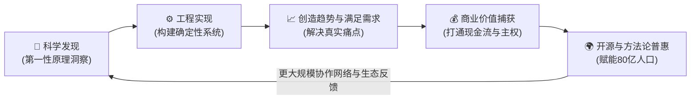

# 《从科学工程到80亿人：现实主权开源白皮书》
## From Science & Engineering to 8 Billion: The Reality Sovereignty Open Manifesto

> **人类负责生活与意图 (Vibe)，AI 负责 7×24h 搞钱 (Earning)；打不过 AI 就圈养 AI，以终为始直奔现实主权。**  
> *Wenbo Ge (`gewenbo.eth` / `@TrustlessX`) · Psyverse Ecosystem*

---

### 序言：第一性原理的正和飞轮

传统工业与互联网时代的竞争往往陷入**零和博弈**：垄断资本掌控生产资料，劳动者以出卖肉身工时交换面包，地缘壁垒阻碍财富流转。而在以大模型和自主智能体为核心的硅基文明纪元，边际成本趋近于零，算力正在以超指数级膨胀。

面对这一巨变，人类通往自由的终极路径不是抵制 AI，也不是困在真空中单纯进行没有商业转化的学术刷榜或赛博编码。

我们提出**「文明级正和博弈超级正反馈飞轮」**：



---

### 第一章 科学（Science）：追问第一性原理

1. **价值的物理学本质**：价值不是工时的机械累计，而是「有效解决熵增问题并满足真实需求」的能量与信息交换。
2. **算力即新生产资料**：开源大模型与边缘计算使得个人首次拥有比肩传统百人团队的算力杠杆。
3. **消除中介摩擦**：Web3 EVM 链上智能合约与无许可加密结算，使价值流转摆脱了传统金融长达数天的结算周期与高额抽成。

---

### 第二章 技术与工程（Engineering）：把偶然变成确定性

工程的本质是在约束条件下构建可稳定复现的系统。一个人即是一座现代化工业联合体：

1. **分布式算力造币矩阵（蓝果短剧 BlueFruit）**：
   - 调度 12 个独立 GPU 节点集群（涵盖角色一致性、首尾帧视频合成、CosyVoice 声音克隆与 FFmpeg 确定性混剪）。
   - 将真人短剧制作成本打掉 92%，7 天完成整季工业级渲染，突破高门槛特效制作壁垒。
2. **多智能体自适应打金舰队（Bounty Hunter & Algora）**：
   - 自主扫描全球开源悬赏（Polar.sh、Algora、GitHub Issues）。
   - 采取手术刀式最小补丁与行为级单测，实战 48 小时 6 个 PR 100% 合并，斩获 $650+ USDC 现金流确权。
3. **全自动无头自贩机（Digital Vending Machine & Pixiu）**：
   - 原生支持微信支付、支付宝、EVM 多链（Arbitrum / Base / Polygon）与 PayPal。
   - 0% 平台抽成，秒级支付检测，全自动发放加密交付包。

---

### 第三章 满足需求与创造趋势（Trend & Market）：领先半步

1. **存量优化**：为全球企业与个人提供极低成本的开源替代方案、代码漏洞修复与多语言视频本地化。
2. **增量趋势**：将“人找工具”转变为“意图驱动雇佣军（Vibe Earning）”。人类只需要定义意图、审美品位与生活状态，底层蜂群网络自动搜寻套利与交付机会。

---

### 第四章 商业捕获（Value Capture）：先拿回现实主权

商业闭环是检验工程是否创造真实价值的唯一标准。
- **不卖时间**：拒绝按小时收费的劳务陷阱，构建具有长尾复利的数字资产（Digital Assets）。
- **统一结算中枢**：
  - 官方独立收款凭证：`https://psyverse.fun/payment` (`/payment.json`)
  - 链上 ENS 标识：`gewenbo.eth`
  - 7×24h 自动化对账与异常流控监控（`RevenueWatchdog`）。

---

### 第五章 赋能 80 亿人（Democratization）：硅基普遍基本收入 (Silicon Sovereign UBI)

真正的护城河不是“秘密”，而是“认知迭代速度”与“全球生态协作规模”。

1. **终结生存内卷**：传统官僚主导的税收再分配 UBI 往往伴随着权力垄断与通胀剥削。
2. **硅基雇佣军普及**：
   - 将经过实战验证的 22+ 搞钱配方标准化为 Docker 一键镜像、Shell 部署脚本与开源智能体配置。
   - 每一个地球人（无论是硅谷极客、小城创业者，还是发展中国家青年），只需填入意图与钱包地址，即可在云端运行一套属于自己的造币小队。
3. **重归星空与真理**：
   - 当硅基生产力为 80 亿人托底基本生存底线时，人类文明才真正跨越匮乏陷阱，全面释放探索科学、哲学、艺术与爱的无限潜力。

---

### 附录：快速起航指南 (Quickstart)

```bash
# 1. 克隆硅基搞钱中枢与配方库
git clone https://github.com/gewenbo888/ai-for-money.git
cd ai-for-money

# 2. 启动一键硅基节点（支持 Docker 与原生环境）
./run_node.sh

# 3. 访问本地控制台并配置你的统一收款钱包
open http://localhost:8888
```

*“以终为始，直奔现实主权；打不过 AI 就圈养 AI，赋能全人类共同跨越奇点。”*
